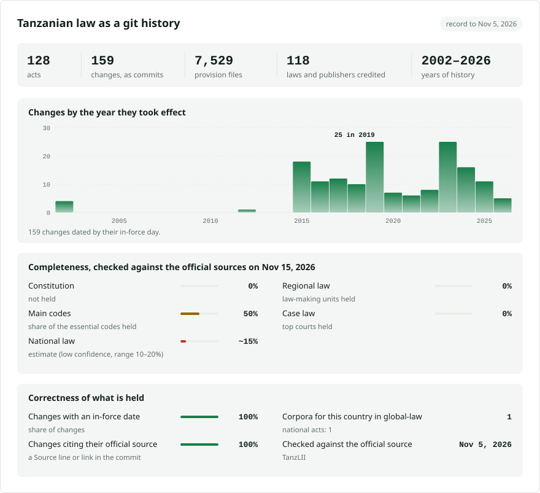

# Tanzania: law history in git

<picture>
<source media="(prefers-color-scheme: dark)" srcset="data/effort-dark.svg">

</picture>

[Kiswahili](README.sw.md)

The law of Tanzania as a git history: one file per section, one commit per version on the day it took effect, and the law that made each change as the commit's author. `git blame` names the law behind every paragraph; `git log` lists every change to a section; picking a date gives the text in force that day.

Part of [lexifina/global-law](https://github.com/lexifina/global-law), one git history for every country's law: this is Tanzania's national law, which global-law reads at `tanzania/national/acts/`.

**What is in it now:** the Constitution (the official English revised text to the 14th Amendment, 2005); 79 consolidated acts of the Revised Laws, among them the Penal Code, the Evidence Act, the Law of Contract Act, the Land Act and the Civil Procedure Code; 745 Acts of Parliament as passed, 1962 to 2026; and 3541 pieces of subsidiary legislation (Government Notices): 4399 dated versions from 1962-07-11 to 2026-10-30. [`STRUCTURE.md`](STRUCTURE.md) gives the layout; [`REPRODUCE.md`](REPRODUCE.md) the sources and the acts held back.

The Constitution is `constitution/`, one file per article. Each consolidated act is a folder `revised-laws/cap-NNN-<short title>/` named by its chapter in the Revised Laws, with one file per section or schedule (`revised-laws/cap-016-penal-code/sec-321.md` is section 321 of the Penal Code, Cap. 16, on setting fire to crops). Each Act of Parliament is a folder `acts/<year>/<number>-<short title>/` (`acts/2025/004-labour-laws-amendments-act/` is the Labour Laws (Amendments) Act, 2025, No. 4 of 2025).

The text is in English, as TanzLII and the Parliament publish them, except 1336 Acts of Parliament enacted in Kiswahili; TanzLII's editorial notes (kept only where a provision has no other text) and the Part and Chapter headings are left out.

## Questions as git commands

| Question | Command |
| --- | --- |
| Every change to section 321 of the Penal Code | `git log -p --word-diff -- revised-laws/cap-016-penal-code/sec-321.md` |
| Which law wrote each line of section 321? | `git blame revised-laws/cap-016-penal-code/sec-321.md` |
| Every version of the Penal Code, with the day each took effect | `git log --format="%h %(trailers:key=In-force,valueonly,separator=) %an" -- revised-laws/cap-016-penal-code ':!revised-laws/cap-016-penal-code/README.md'` |
| Section 321 as in force on 1 January 2020 | `python tools/on.py 2020-01-01 revised-laws/cap-016-penal-code sec-321` |

**Outside git**, we also host this record publicly, for free:

- **[Ask Claude about Tanzanian law](https://global-law.lexifina.com/v1/try_claude?country=tanzania)**: opens Claude with a first question ready.
- **[Ask ChatGPT](https://global-law.lexifina.com/v1/try_chatgpt?country=tanzania)**: the same question in ChatGPT.
- **[Search Tanzanian law on our site](https://lexifina.com/law?country=tanzania&q=annual+leave)**: a search for "annual leave", with each provision's text and its versions, no account needed.
- **[Developer REST API](https://global-law.lexifina.com/v1/search_law?query=annual+leave&jurisdiction=tanzania)**: the same search as JSON, with no key. See the [documentation here](https://lexifina.com/api/global-law).

Both assistants read the record through the free Global law connector (MCP, `https://global-law.lexifina.com/mcp`); the first time, the chat gives you the link that adds it. Ask in English or in Kiswahili.

**Host it yourself easily.** All it takes is git and Python, and the tools run on your machine:

```sh
git clone --depth 1 https://github.com/lexifina/global-law && cd global-law
python3 tools/countries.py add tanzania/national/acts
python3 tools/law.py show 2026-01-01 tanzania/national/acts/revised-laws/cap-016-penal-code/sec-321.md
```

Opened in Claude Code, Cursor, VS Code or Codex, the clone also starts a local MCP server with the same tools ([MCP.md](https://github.com/lexifina/global-law/blob/main/MCP.md)).

## Dates

Each commit is dated at noon, Africa/Dar_es_Salaam, on the day the version took effect, and carries it in its `In-force:` trailer:

- for a TanzLII act, the date of TanzLII's point-in-time version (expression): for an amendment, the day it came into force, as TanzLII's amendment list gives it; for a revised edition, the day the edition is as at (the Revised Laws of 31 July 2002, 30 November 2019 and 31 December 2023);
- for a TanzLII act as enacted, its Gazette publication, or the commencement day TanzLII states (the Judiciary Administration Act, published on 10 June 2011, is dated 1 March 2012);
- for an Act of Parliament, the date printed under its long title or with the assent; a later commencement day is not shown. Where no day is printed, the commit is placed on 1 July of its year and says so in a `Date-placeholder:` trailer; days before 1970 are in the `In-force:` trailer, the commit date being held at 1 January 1970;
- for an Act or a Government Notice from the Attorney General's portal, the commencement day it gives, else the day of publication in the Gazette (`In-force-basis:` says which); for a revised chapter, the day it is revised up to;
- for an Act or a Government Notice from the Attorney General's portal, the commencement day it gives, else the day of publication in the Gazette (`In-force-basis:` says which); for a revised chapter, the day it is revised up to;
- for an Act or a Government Notice from the Attorney General's portal, the commencement day it gives, else the day of publication in the Gazette (`In-force-basis:` says which); for a revised chapter, the day it is revised up to;
- for an Act or a Government Notice from the Attorney General's portal, the commencement day it gives, else the day of publication in the Gazette (`In-force-basis:` says which); for a revised chapter, the day it is revised up to;
- for the Constitution, the day of the 14th Amendment (22 April 2005), the last amendment the official revised text takes in.

Each change is credited to the law TanzLII's History names (`Act 1 of 2022`). Where one version takes in several laws or is a revised edition, a provision is credited to a law only if TanzLII's editorial note in it names that law; the rest are committed by the publisher (`TanzLII`) and labelled unexplained (12 commits). The first version of the Judiciary Administration Act is the act as enacted, credited to Act 4 of 2011; for the other 20 TanzLII acts it is the "oldest version available", credited to TanzLII. Each Act of Parliament is credited to itself (`Act 4 of 2025`).

## How it is checked

- `tools/check_repo.py` reads every version back from git on the day it took effect and on the day before, and compares it with the corpus: 150 versions of 128 acts, 0 mismatches; every commit's trailers parse (see [`REPRODUCE.md`](REPRODUCE.md)).
- Every TanzLII version is parsed from an archived copy of its own dated expression page, whose sha256 is in `data/versions.json`; an act's newest version is the expression TanzLII's own listing named as current when it was retrieved (October 2026).
- Every word of an Act of Parliament, from the long title to the end, is in a file, checked letter for letter (page numbers, running heads and Part headings aside); an Act whose sections do not run 1, 2, 3 without a gap is kept whole in one file, `text.md`, and its commit says `Layout: whole text`.
- History is append-only: no merge commits and no commit date that goes backwards.
- [vulnerabilities/](vulnerabilities/): possible drafting mistakes in this law, found by global-law's detectors and checked by hand. Not run yet.

## What it does not show

- **Most Tanzanian law.** Subsidiary legislation only as the Attorney General's portal lists it (mostly 2016 on), without notices that only license a named firm, appoint someone or set an election calendar; no Zanzibar law (the House of Representatives' copies are scans without a text layer) and no case law here (TanzLII and ZanzibarLII refuse automated access). The Revised Edition 2023 chapters, published by the Office of the Solicitor General and on the Attorney General's portal, are held back: each page says it may not be reproduced without the Attorney General's permission, so a chapter's latest version here is the Revised Edition 2019, 2020 or 2022.
- **Changes before TanzLII's oldest version.** 4 acts start at the Revised Laws 2002, 12 at the Revised Laws 2019 and 4 at their version of 14 March 2025; a listed version with no archived text (the Law of Marriage Act's of 15 July 2022) is folded into the next.
- **Which Act made the Revised Laws 2023's changes.** TanzLII publishes the edition as a consolidation, so wording it changed is credited to `TanzLII` unless a note names an Act; each such commit message names the Acts the version also takes in.
- **Later changes to the Acts of Parliament.** Each is the Act as passed: amendments are not applied to it, and each amending Act is its own folder. Scanned copies without a text layer are left out (no OCR); where the copy carries the publisher's own recognised text, it is used and the commit says `Text-source: publisher OCR`.
- **Changes within a line.** Each paragraph is one line, so blame credits a whole paragraph; use `git log -p --word-diff` for the words.

## Sources

| Source | Kind | Past versions | Notes |
| --- | --- | --- | --- |
| [TanzLII](https://tanzlii.org) (Judiciary of Tanzania, on the Laws.Africa Peachjam platform) | Legal information institute: consolidated acts | yes, each dated point-in-time version | The text, the day each version took effect, the History and amendment lists, and editorial notes naming the amending laws |
| [Parliament of Tanzania](https://polis.bunge.go.tz/) (Bunge la Tanzania), Acts list | Acts of Parliament as passed (Act Supplement to the Gazette) | no, the Act as passed | Read from the text layer of each PDF; no OCR |
| [Ministry of Constitutional and Legal Affairs](https://nalis.sheria.go.tz/en/constitution) (NaLIS) | The Constitution, official revised text in English (Cap. 2) | no, one revised text (to 2005) | Read from the PDF's text layer |
| [Office of the Attorney General](https://oagmis.oag.go.tz/public) (OAG MIS legislation portal) | Acts as passed, Revised Laws chapters (Revised Editions 2019 to 2024), Government Notices | one copy per edition | Read from the text layer of each PDF; copies marked "no part may be reproduced without permission of OAG" are held |
| [FAOLEX](https://www.fao.org/faolex/) (FAO), listed through [ECOLEX](https://www.ecolex.org) | Secondary copies: Acts and Government Notices not on an official host | no, one copy per record | Only where no official copy is held; each commit says `Source-status: secondary copy (FAOLEX, <URL>)` and is dated by the day printed in the copy |
| [FAOLEX](https://www.fao.org/faolex/) (FAO), listed through [ECOLEX](https://www.ecolex.org) | Secondary copies: Acts and Government Notices not on an official host | no, one copy per record | Only where no official copy is held; each commit says `Source-status: secondary copy (FAOLEX, <URL>)` and is dated by the day printed in the copy |
| [FAOLEX](https://www.fao.org/faolex/) (FAO), listed through [ECOLEX](https://www.ecolex.org) | Secondary copies: Acts and Government Notices not on an official host | no, one copy per record | Only where no official copy is held; each commit says `Source-status: secondary copy (FAOLEX, <URL>)` and is dated by the day printed in the copy |
| [Internet Archive](https://web.archive.org/) | Archived copies of TanzLII's pages | as archived | The copy read for each version whose address in `data/versions.json` is on web.archive.org |

## Licence

See [`LICENSE`](LICENSE). TanzLII's texts are under CC BY-NC 4.0 with TanzLII credited as the source, so they may be used only for non-commercial purposes; neither TanzLII nor Laws.Africa endorses this repository. The Acts of Parliament are reproduced without change: the Copyright and Neighbouring Rights Act (Cap. 218), section 7, gives no protection to laws. Lexifina's arrangement, commit messages, tables and tools are CC0 1.0.

No AI model wrote, translated or corrected legal text, and none runs at build time; the scripts were written by an AI model (see [`REPRODUCE.md`](REPRODUCE.md)).

## Visualisations

- [visualisations/](visualisations/): charts drawn from this repository. Not drawn yet.

## More

From [lexifina/global-law](https://github.com/lexifina/global-law):

- [FEATURES.md](https://github.com/lexifina/global-law/blob/main/FEATURES.md): every feature, and what every corpus must support (`git blame`, `law.py`, the MCP tools)
- [FAQ.md](https://github.com/lexifina/global-law/blob/main/FAQ.md): questions and answers · [CONTRIBUTING.md](https://github.com/lexifina/global-law/blob/main/CONTRIBUTING.md): proposing changes · [MCP.md](https://github.com/lexifina/global-law/blob/main/MCP.md): the MCP server · [REPRODUCE.md](https://github.com/lexifina/global-law/blob/main/REPRODUCE.md): how it was built · [CHANGELOG.md](https://github.com/lexifina/global-law/blob/main/CHANGELOG.md)
- [FRESHNESS.md](https://github.com/lexifina/global-law/blob/main/FRESHNESS.md): how current each corpus is · [Monitoring](https://github.com/lexifina/global-law/tree/main/monitoring): whether updates are running · [WATCHING.md](https://github.com/lexifina/global-law/blob/main/WATCHING.md): how each official source is watched for changes
- [performance/](https://github.com/lexifina/global-law/tree/main/performance): how fast the tools are, measured
- [visualisations/](https://github.com/lexifina/global-law/tree/main/visualisations): charts and bridges across the world's law
- [Vulnerabilities](https://github.com/lexifina/global-law/tree/main/vulnerabilities): mistakes in legislation as published
